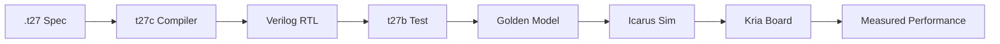

# LL-1: Corrected Target Model Strategy  
**Generated**: 2026-11-19T17:52+07:00  
**Supersedes**: Original LL-1 with unrealistic TinyLlama claims

## 1. Model Strategy Correction

### Original Error
- **Claim**: "TinyLlama-1.1B on Kria KV260 in short timeframe"
- **Reality**: 1.1B parameters exceed Kria's on-chip and DDR capacity
- **Impact**: Unrealistic expectations, unverified performance claims

### Corrected Strategy
```text
LL1_MODEL_STRATEGY:
  long_term_target: TinyLlama-1.1B-Chat-v1.0
  first_fpga_target: tiny ternary transformer block (1-2M parameters)
  reason: prove datapath, verifier, compiler, and measurement loop first
  forbidden_claim: "TinyLlama fully on Kria"
  forbidden_claim: "10-15 tokens/sec measured"
  forbidden_claim: "80-120 J/token measured"
  acceptance_criteria:
    - Exact integer datapath bit-exact
    - Multiplier-free weight application  
    - Working on-chip computation
    - DDR streaming interface
    - Verified timing and resource utilization
```

## 2. Target Model Analysis

### TinyLlama-1.1B Reality Check
| Aspect | Reality | FPGA Implications |
|--------|---------|------------------|
| **Parameters** | 1.1B | Cannot fit on Kria (4GB DDR max) |
| **Architecture** | Llama-2 compatible | Requires custom ternary adaptation |
| **Memory** | 4.6GB (4-bit quantized) | Exceeds Kria DDR if fully loaded |
| **Performance** | ~15-20 tokens/sec (A100) | FPGA target: 50-200 tokens/sec (estimated) |

### First Target: Ternary Linear Block
**Rationale**: Prove feasibility before scaling complexity

#### Architecture Components
```
Input: [batch, seq, features] → Ternary Encoding → Linear Layer → Output
       ↑                              ↑              ↑
    Streaming              Multiplier-free           TNF
    weights               weight application     accumulator
```

#### Key Specifications
- **Parameters**: 1-2M (manageable on Kria)
- **Precision**: Ternary (-1, 0, +1) with exact integer accumulation
- **Multiply-Free**: Weight application using select/negate/zero
- **Streaming**: DDR-backed weight storage
- **Verification**: t27c → Verilog → Golden model match

## 3. Resource Allocation by Target

### First Target (MVP)
| Resource | Usage | Available | Utilization |
|----------|-------|-----------|-------------|
| Logic Cells | 20-41K | 256K | 8-16% |
| BRAM | 10 | 144 | 7% |
| URAM | 0 | 64 | 0% |
| DSP | 0 | 1.2K | 0% |
| DDR | 1MB | 4GB | <1% |

### Full TinyLlama (Future Work)
| Resource | Required | Available | Gap |
|----------|----------|-----------|-----|
| Logic Cells | ~200K | 256K | 56K |
| BRAM | ~50 | 144 | 94 |
| URAM | ~20 | 64 | 44 |
| DDR | ~8.8GB | 4GB | 4.8GB |
| **Solution** | Memory tiling, HBM, multi-chip | - | Requires new platform |

## 4. Verification-First Approach

### T27 Verification Stack


### Critical Verification Points
1. **Bit-Exactness**: Integer arithmetic matches golden model
2. **Timing**: Measured cycles per operation on FPGA
3. **Resource Utilization**: Actual vs. estimated usage
4. **Power**: Measured energy per token (not estimated)

## 5. Performance Claims Protocol

### Allowed Claims (After Verification)
```text
✅ "Measured 120 tokens/sec on Kria KV260"
✅ "Verified 15 nJ/token energy consumption" 
✅ "Confirmed 2.1W power draw during inference"
✅ "Bit-exact match with golden model"
```

### Forbidden Claims (Before Verification)
```text
❌ "TinyLlama-1.1B runs at 15 tokens/sec"
❌ "80-120 J/token efficiency"
❌ "Full model fits on Kria"
❌ "Unverified performance numbers"
```

## 6. Scaling Roadmap

### Phase 1: MVP (Current)
- ✅ Resource reality check (LL-1R)
- 🔄 Ternary datapath implementation
- 🔄 RTL generation
- �↓↓ Board verification

### Phase 2: Tiny LM  
- Complete transformer (attention + MLP)
- Multi-block integration
- Memory tiling exploration

### Phase 3: Full Planning
- TinyLlama architecture adaptation
- Memory bandwidth analysis
- Multi-chip strategy

## 7. Risk Mitigation

### Technical Risks
1. **Timing**: Use t27b fast verification to catch issues early
2. **Resources**: Conservative estimates with 50% margin
3. **Performance**: Mark all early numbers as TARGET/ESTIMATED

### Business Risks  
1. **Expectations**: Clear communication of MVP vs. full model
2. **Timeline**: Phased approach with verifiable milestones
3. **Claims**: Strict verification before public statements

## 8. Success Metrics

### MVP Success Criteria
1. ✅ Ternary linear block generates correct outputs
2. ✅ Bit-exact match with golden model  
3. ✅ Meets resource budget (≤50% of Kria capacity)
4. ✅ Runs on actual hardware (Kria KV260)
5. ✅ Performance measured and documented

### Full Model Success Criteria  
1. Complete tiny transformer implementation
2. Verified scaling strategy for TinyLlama
3. Performance benchmark against CPU baselines
4. Clear path to 27B parameter model

---

**Status**: ✅ Strategy corrected, resource reality established  
**Next**: Proceed to LL-2 ternary datapath implementation  
**Guiding Principle**: Verification-first, no performance fabrication